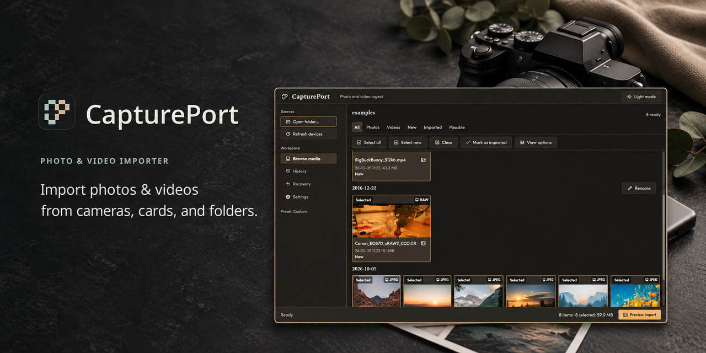

# CapturePort

[English](README.md) | [简体中文](README.zh-CN.md)

CapturePort 帮你把相机、存储卡或文件夹里的照片和视频，安全地复制到指定位置。开始复制前，你就能看到每个文件将存放在哪里。

这是一款原生 Linux 应用，灵感来自经典的 Windows「导入图片和视频」向导。它不使用专有的媒体库格式，也不要求你把文件交给某个目录管理系统：照片和视频就保存在普通文件夹里。CapturePort 只负责安全导入，不承担导入后的编辑、评分或整理工作。

## 如何保护你的文件

- **先看清楚，再开始导入。** 应用会先生成导入计划，列出每个文件的最终存放路径。你确认之前，不会复制任何文件。
- **原始文件留在原处。** 导入不会移动或删除源文件。如果需要删除原始文件，必须另行操作并单独确认。
- **没完成，就不算导入成功。** 文件先以临时名称复制，验证通过后，再通过原子操作转为正式文件，最后才记入导入历史。
- **不会直接覆盖同名文件。** 文件名冲突会在生成计划时处理，处理结果也会显示在预览中。
- **疑似重复的文件，由你决定。** 如果某个文件可能已经导入过，应用会标记「可能重复」，并显示它匹配的历史导入批次，而不是悄悄跳过。

## 安装

### 一条命令安装（Linux x86_64）

```sh
curl -fsSL https://raw.githubusercontent.com/Alchemist-Aloha/CapturePort/main/scripts/install.sh | sh
```

只需 `curl` 和标准 Linux 命令行工具，无需 sudo，也不用安装 Rust 或自行编译。安装脚本会从[最新 GitHub Release](https://github.com/Alchemist-Aloha/CapturePort/releases/latest) 下载预编译程序，使用该版本的 `SHA256SUMS` 校验文件，然后安装到 `~/.local/bin/captureport`。

更新时，再运行一次同样的命令即可。如果下载或校验失败，现有安装不会受到影响。

如果 `~/.local/bin` 尚未加入 PATH，可以把下面这行加入 shell 配置文件并重新加载，也可以先在当前终端中运行：

```sh
export PATH="$HOME/.local/bin:$PATH"
```

安装后，运行 `captureport` 即可启动，也可以直接运行 `~/.local/bin/captureport`。

卸载时运行 `rm ~/.local/bin/captureport`，设置和导入历史都会保留。安装脚本不会安装系统库或桌面启动器。预编译程序在 Ubuntu 24.04 上构建，运行时需要兼容的系统库。

### 发行版安装包

GitHub Release 还提供 Debian/Ubuntu（`.deb`）、Arch（pacman）、Fedora（`.rpm`）安装包，以及便携压缩包。

每次推送分支或标签，GitHub Actions 的 **Linux packages** 工作流都会构建 x86_64 安装包。开发版可以在相应运行记录的 **Artifacts** 中下载。

运行需要：

- 支持 Vulkan 的图形环境，以及 GPUI 支持的 Linux 驱动；
- `libgphoto2`，用于访问 PTP 相机；
- `lsblk`、`udisksctl` 和系统 UDisks 服务，用于挂载存储卡。

## 导入照片

1. **选择来源。** 连接相机或插入存储卡后，设备会出现在「来源」列表中。也可以点击「打开文件夹…」，选择磁盘上的文件夹。尚未挂载的存储卡会显示「挂载」按钮。
2. **查看扫描结果。** 应用会显示各项媒体的缩略图、拍摄时间、文件大小和导入状态。已经导入过的文件会被标记，并取消默认选中，只保留新文件的默认选择。你可以使用「全部 / 照片 / 视频 / 新文件 / 已导入 / 可能重复」进行筛选，也可以在「查看选项」中按拍摄时间或名称排序、调整缩略图大小。点击文件名旁的详情图标，可查看预览、元数据和原始路径；点击「原始文件」可复制其 URL，成功后会显示「URL 已复制」。
3. **选中要导入的文件。** 可以逐项选择，也可以使用「选择全部」或「选择新的」。点击图库中的拍摄组标题，可选中整组文件。
4. **检查导入计划。** 点击「预览导入」，查看每个文件的目标路径，以及待复制、跳过和被阻止的文件数量。
5. **确认并开始复制。** 已有文件、文件名冲突和无法读取的媒体，都需要在复制前处理。每份副本验证通过后，才会转为正式文件。导入期间，无论你在哪个页面，都能看到当前文件及其目标位置、当前副本与整体的进度、已验证的副本数量和传输速度，也可以点击「取消导入」。
6. **查看导入记录。** 「历史」会列出每次导入及其生成的目标文件。

## 界面语言

在 **设置 → 语言** 中，可以随时切换 English、简体中文、繁體中文、Español、Français、Deutsch、Português、日本語、한국어 和 Italiano。切换立即生效，选择会自动保存，使用时无需联网。

选择「系统语言」时，应用会依次检查 `LC_ALL`、`LC_MESSAGES` 和 `LANG`。如果系统语言不受支持，则使用英语。

语言设置只影响界面，不会改动文件名、路径、模板语法或你自定义的名称。使用中文、日文或韩文时，请确保系统已安装相应字体，例如 Noto Sans CJK。

## 支持哪些来源

- **文件夹** — 可以选择任意目录。应用以只读方式扫描其中的文件和子目录。
- **存储卡** — 自动发现 `/media` 和 `/run/media` 下已挂载的存储设备。尚未挂载的存储卡会显示「挂载」按钮，需要你主动点击；相关权限由系统 UDisks 服务管理。
- **相机** — 通过 libgphoto2 检测 PTP 相机，无需挂载，直接浏览。

点击「刷新设备」，或在尚未打开来源时使用 **Scan for cameras**，可以立即扫描设备。检测到的存储卡会显示设备型号和挂载目录。

## 设置存放位置和命名规则

打开「设置」，可以调整以下导入规则：

- **预设** — 输入名称，点击「创建预设」，即可保存设置页面中的各项配置，包括浏览、外观和来源别名。点击已保存的预设名称即可加载，也可以「重命名」「覆盖」或「删除预设」。覆盖和删除都需要确认。加载预设中的别名后，还需要点击「保存源别名」，才会将它保存为当前设备的别名。
- **目标位置** — 分别指定照片和视频的根目录。
- **文件夹和文件名模板** — 根据媒体信息自动生成路径。例如，文件夹可使用 `{year}/{date:%Y-%m-%d}/{camera_model}`，文件名可使用 `{datetime:%Y-%m-%d_%H-%M-%S}_{sequence:04}.{extension}`。模板输入框提供语法说明和实时示例，点击模板片段即可插入。可用信息包括日期与时间、相机与镜头、尺寸、方向、时长、GPS、原始时间戳和文件大小。
- **分组** — 按拍摄时间间隔划分拍摄组。如果希望每组单独存放，可以在文件夹模板中使用 `{session}`（组编号）或 `{session_name}`（图库中的组名称）。
- **时钟校正** — 修正相机记录的拍摄时间，或指定相机使用的 UTC 偏移，让文件归入实际拍摄日期对应的目录。
- **验证、文件冲突和文件组** — 选择副本验证的严格程度、遇到同名文件时的处理方式，以及如何处理 RAW+JPEG 配对文件。
- **排除的文件夹** — 在「媒体发现」中输入文件夹名称或部分路径，例如 `Screenshots, DCIM/Private`。匹配的文件夹及其子目录不会参与扫描或导入。匹配区分大小写；应用设置后，需要重新扫描才能更新浏览结果。
- **备份目标位置** — 可另外指定备份目录，为所有文件多保存一份副本。

完整的模板片段列表，以及缺失元数据时的处理方式，见[目标位置规则](docs/spec.md#20-destination-rules)。文件最终会存放在哪里，以导入预览显示的路径为准。

## 导入历史与中断恢复

「历史」记录每次导入及其生成的各份副本。

如果导入中断，「恢复」会列出未完成的导入批次，以及 CapturePort 创建的不完整文件。重新连接来源后，可以为剩余文件生成新的导入预览。

清理不完整文件和删除原始文件是两项独立操作，都需要分别确认。

## 手动标记已导入的文件

如果某些文件已经通过其他方式导入，可以选中它们，再点击「标记为已导入」。

这项操作只记录你的标记，不会复制文件，也不会生成经过验证的导入记录。重新扫描或重启应用后，「手动标记」状态仍会保留。

## 键盘快捷键

| 按键 | 操作 |
| --- | --- |
| `Ctrl+O` | 打开文件夹 |
| `Ctrl+A` | 选中所有可见项目 |
| `Ctrl+Shift+A` | 选中所有可见的新项目 |
| `Escape` | 在浏览页面取消选择 |
| `Ctrl+I` | 打开导入预览（在检查页面再次按下，即开始复制） |

## 数据保存在哪里

CapturePort 遵循 XDG 基础目录规范，分别保存：

- **配置** — 导入设置、外观和图库名称。
- **数据** — 目录数据库和导入历史。
- **缓存** — 缩略图，可随时安全删除。

数据库只用于加速导入和记录历史，不负责保管照片或视频。即使删除数据库，已经导入的文件仍在原来的文件夹里，可以照常查找和使用。

## 外观

应用内置四种配色方案：**Pine（松树）**、**Darkroom（暗室）**、**Graphite（石墨）** 和 **Ink（墨水）**，每种都提供浅色和深色模式。

在顶部切换浅色或深色模式，在「设置」中选择配色方案。

## 没有设备，也能试用

应用内置演示数据，方便你体验界面或复现问题。可用的演示场景有：`--demo empty`、`--demo camera`、`--demo importing`、`--demo errors` 和 `--demo 10000`。

演示场景固定，便于重复测试；使用内存数据库，不会把模拟记录写入真实的导入历史。

```sh
captureport --demo camera
```

## 开发者指南

```sh
rtk cargo test --workspace --offline
rtk cargo run -p captureport --offline
```

从源码构建需要 Rust 1.88 或更高版本、Cargo、C 编译器、GPUI 所需的 Linux 图形开发库，以及系统 `libgphoto2` 和 `libgphoto2_port` 的开发文件。

打包和基准测试命令见 [docs/build-and-benchmarks.md](docs/build-and-benchmarks.md)。

- [docs/spec.md](docs/spec.md) — 产品与行为规范。
- [docs/plan.md](docs/plan.md) — 分阶段开发计划。
- [DESIGN.md](DESIGN.md) — 视觉设计规范。

应用采用 MIT 许可证。随安装包提供的 Spectral、Outfit 字体和 Material Symbols Outlined 图标集，均附有各自的许可证。
